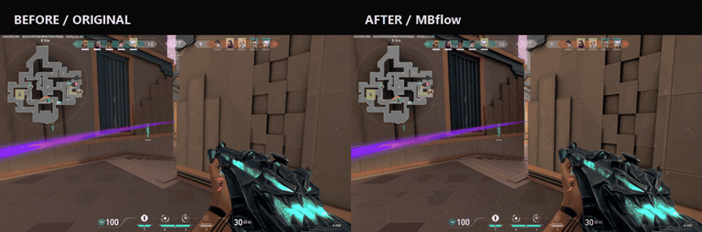
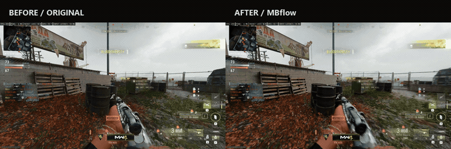
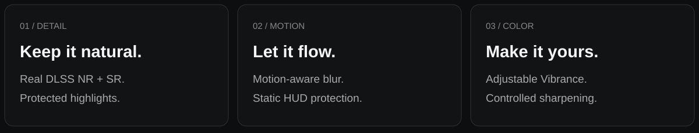
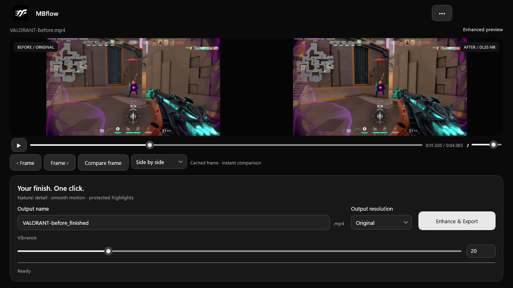
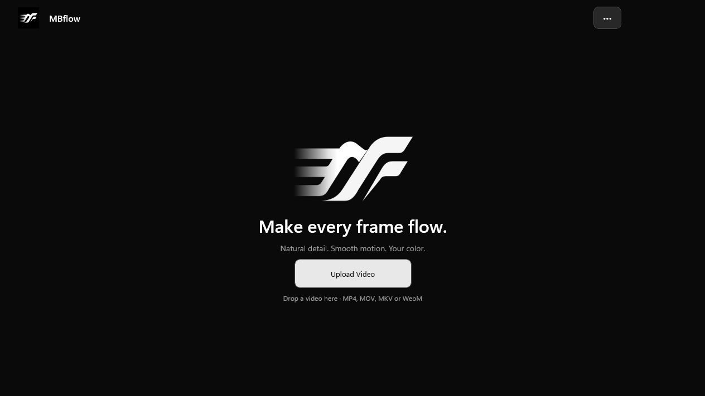
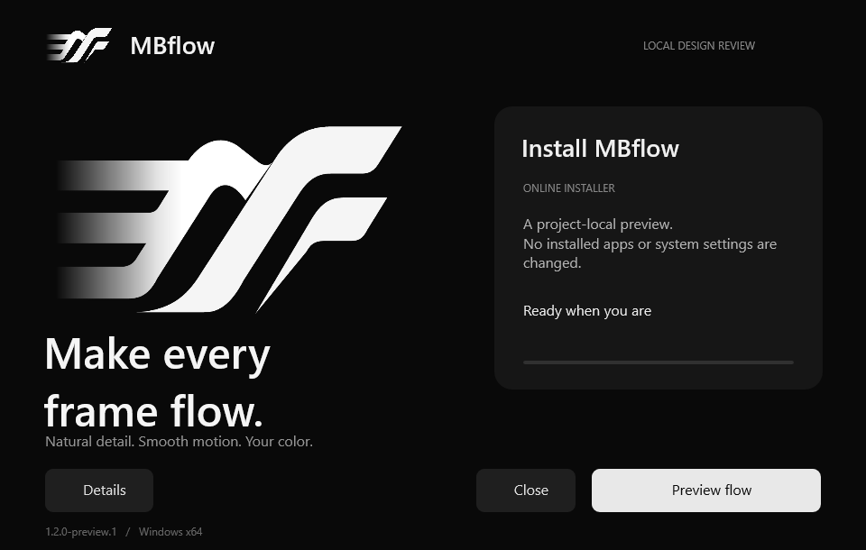
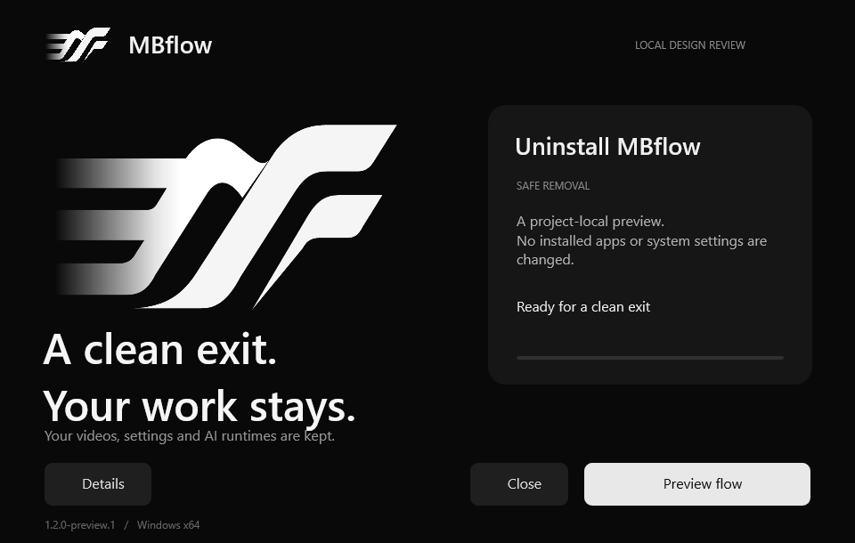

<h1 align="center">A better finish for your best moments.</h1>

Natural detail. Smooth motion. Your color.

  

## See the difference

Same moment. Same framing. A different finish.

### VALORANT

**Before:** original viewing copy. **After:** MBflow's current NR and motion-blur pipeline. No CAS. No generated frames.

### Call of Duty

Motion-aware blur gives fast camera movement a softer, more continuous look while protecting static HUD edges.

*Silent presentation copies; the application retains source FPS and audio. Watch the MP4 comparisons: [VALORANT](https://github.com/iiMBdr/MBflow-Releases/releases/download/update-service-v1.2.0/valorant-comparison.mp4) · [Call of Duty](https://github.com/iiMBdr/MBflow-Releases/releases/download/update-service-v1.2.0/call-of-duty-comparison.mp4).*

## Detail. Motion. Color.

| Natural detail | Smoother motion | Your color |
| --- | --- | --- |
| DLSS Neural Rendering and Super Resolution through the experimental runtime integration, with explicit feature checks. | Motion-compensated blur with HUD and shot-transition protection. | Adjust Vibrance, keep the detail, and finish with controlled sharpening. |

## Three steps. One finish.

1. **Upload your video.** Drop a clip into MBflow. Metadata opens without a full frame analysis.
2. **Make it yours.** Set the output name, resolution and Vibrance. Compare the same frame with Original, Enhanced, Side by side or Wipe.
3. **Enhance & Export.** Follow progress, cancel when needed, then open the completed output.

## Choose your download

| Package | Best for | Includes |
| --- | --- | --- |
| **Offline** | Setting up without another application download. | MBflow, .NET, WinUI, FFmpeg and redistributable native dependencies. |
| **Online** | A smaller installer and a connected computer. | Downloads the approved package and verifies its SHA256. |

**MBflow 1.2.0:** [Download Offline](https://github.com/iiMBdr/MBflow-Releases/releases/download/v1.2.0/MBflow-Setup-Offline.exe) · [Download Online](https://github.com/iiMBdr/MBflow-Releases/releases/download/v1.2.0/MBflow-Setup-Online.exe) · [Checksums](https://github.com/iiMBdr/MBflow-Releases/releases/download/update-service-v1.2.0/SHA256SUMS.txt)

## Clean setup. Clean exit.

A matching installation and removal experience. Uninstall removes the application while keeping your videos, settings and AI runtimes. An active export must finish or be cancelled first.

## Before you start

- Windows 11 x64 and a compatible NVIDIA GPU/driver with working D3D12 and NVENC.
- The selected DLSS runtimes must be available and pass their feature checks. Public releases do not include the locally provided proprietary NR runtime.
- Local GPU validation uses RTX 4070 12 GB. Compatibility on other hardware is not certified.

## A few honest answers

**Is this frame generation?** No. The basic application preserves source FPS and timing. Preview Lab is a separate experiment.

**Is enhanced playback instant?** Processing takes time. The basic application plays the source and evaluates enhanced frames for inspection; it does not promise real-time neural processing.

**Is output lossless?** No. HEVC Main10 is lossy. Export protects the source size/bitrate budget and scales that budget with enlargement, so files can be significantly larger.

**Can it recover a completely blown-out sky?** Highlight protection retains detail available in the source. Already clipped information cannot be guaranteed recoverable.

**Is this the same as an in-game DLSS integration?** No. Recorded-video processing estimates motion from the clip rather than receiving all game-engine data. Compatibility is experimental.

---

<strong>MBflow</strong> Make every frame flow.

